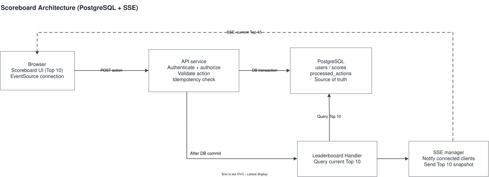

# Scoreboard API

The website shows the current Top 10 scores. When a user completes a valid action, the API awards the points and sends the updated leaderboard to connected browsers over SSE.

## Architecture

Editable diagram: [problem_6_architecture.drawio.svg](./problem_6_architecture.drawio.svg) — open it with [diagrams.net](https://app.diagrams.net/) using **File → Open From → Device**.

## Flow

1. **Load leaderboard** — The browser requests the current Top 10. The API service queries PostgreSQL, ordered by `score DESC, user_id ASC`, and returns the snapshot.
2. **Complete an action** — When a user completes an action, the browser sends the request to the API service. The API authenticates and authorizes the user, then validates the action.
3. **Update score** — In one PostgreSQL transaction, the API records the action in `processed_actions` and increments the user's score. A unique constraint on `action_id` prevents the same action from awarding points twice.
4. **Build leaderboard snapshot** — After the transaction commits, the API service queries the current Top 10 from PostgreSQL, ordered by `score DESC, user_id ASC`.
5. **Push leaderboard update (SSE)** — The SSE manager sends a `leaderboard.updated` event containing the full snapshot to connected browsers. The browser replaces the leaderboard displayed on screen.

## Security

- Authenticate the user and verify authorization before awarding points.
- Validate action completion using server-side data. Never trust a score supplied by the browser.
- Use parameterized SQL or a safe ORM, and rate-limit action requests.

## Consistency

- PostgreSQL is the source of truth.
- Recording the action and incrementing the score happen in the same transaction; both changes commit or roll back together.
- A unique constraint on `action_id` prevents concurrent retries from awarding points twice.
- The leaderboard snapshot is queried after commit, so it reflects committed data visible to that query.
- SSE updates may be missed if the API crashes after the database commit. The browser can fetch the latest leaderboard to recover.

## Failure handling

- **Invalid action:** reject it without changing the score.
- **Database error:** roll back the transaction.
- **Browser disconnect:** remove the closed SSE connection. On reconnect, the browser fetches the current leaderboard again.

## Future improvement

- **Redis:** If many requests read the Top 10, or several API processes run, keep the committed Top 10 in Redis for those reads and for each process to push its own SSE connections. This adds complexity and is not required for the current baseline.
- **Transactional outbox:** If the system later requires reliable delivery of every leaderboard update, store the event in the same PostgreSQL transaction as the score update, then have a worker retry delivery. This adds complexity and is not required for the current baseline.
